# Linksy

Sharing-first file transfer. Select files, create a secure share, let another
person open it through a link or QR code — without installing anything or
making an account.

This repository is a **Phase 1 / 2 foundation**: the complete design system, the
full navigation graph, and every screen in PRD §8 implemented and wired to a
repository layer. The screens are real; the data behind them is local, because
no Firebase project is configured for this build.

<p align="center">
  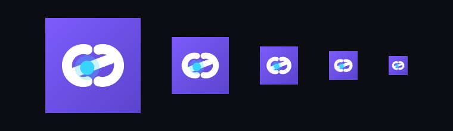
</p>

### The icon

<p align="center">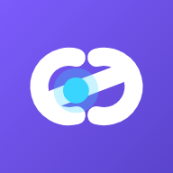</p>

Two interlocking arcs — the two parties — with a cyan packet travelling between
them. The same `CustomPainter` that draws the mark in the app bar also draws the
launcher icon at every size, so they cannot drift apart:

```sh
flutter test test/generate_icons.dart --update-goldens
```

That regenerates all 5 Android mipmaps, all 15 iOS AppIcon sizes, and the 5 web
icons. Maskable variants render the mark at ~60% on a full-bleed plate, because
those platforms crop up to 20% from every edge.

<p align="center">
  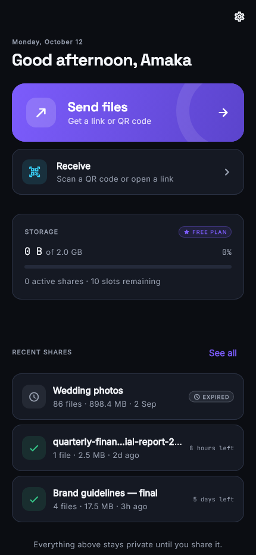
  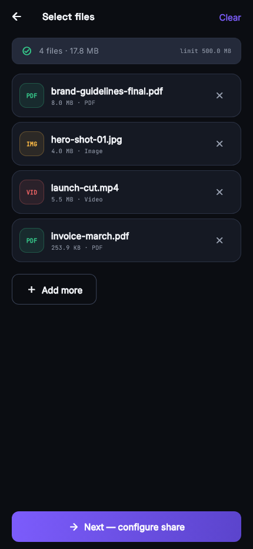
  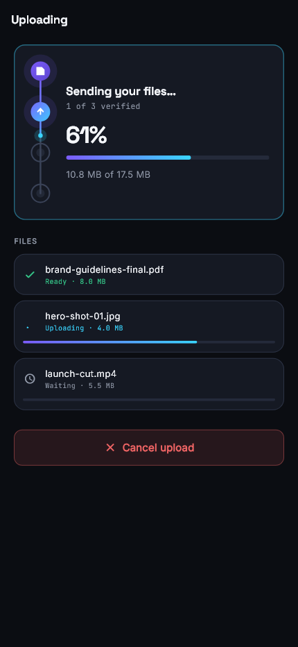
  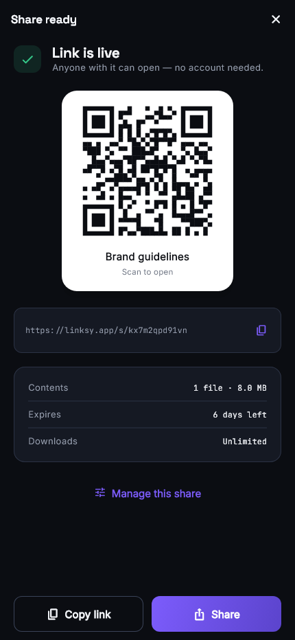
</p>

| | | |
|---|---|---|
| 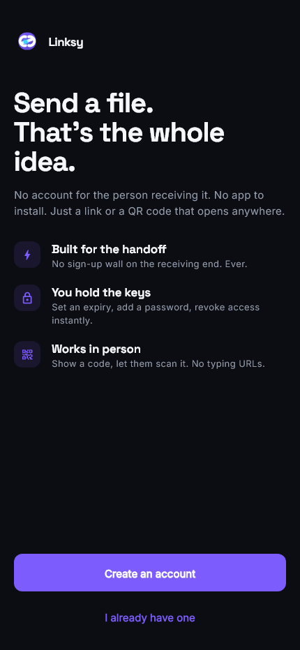 | 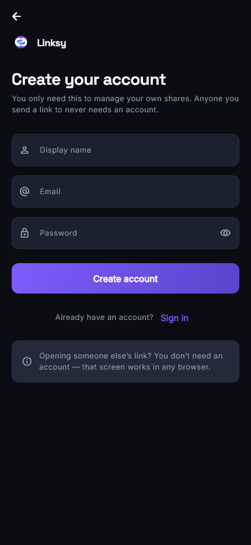 | 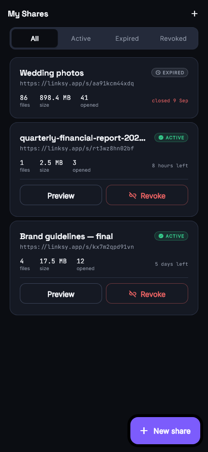 |
| **Welcome** | **Sign in** | **My Shares** |
| 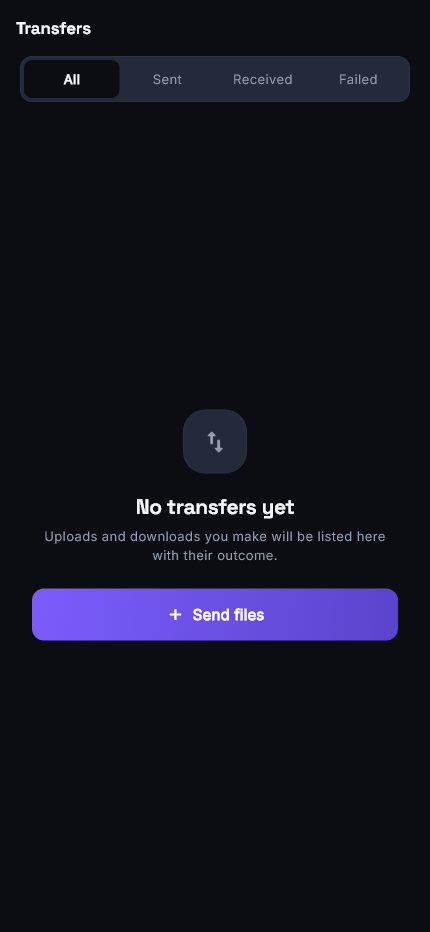 | 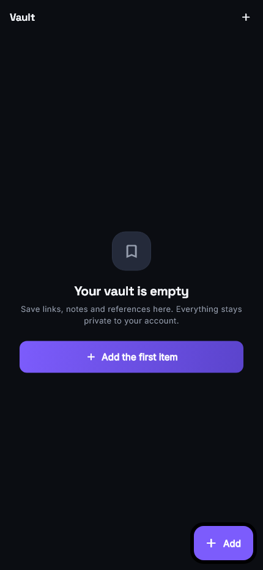 | 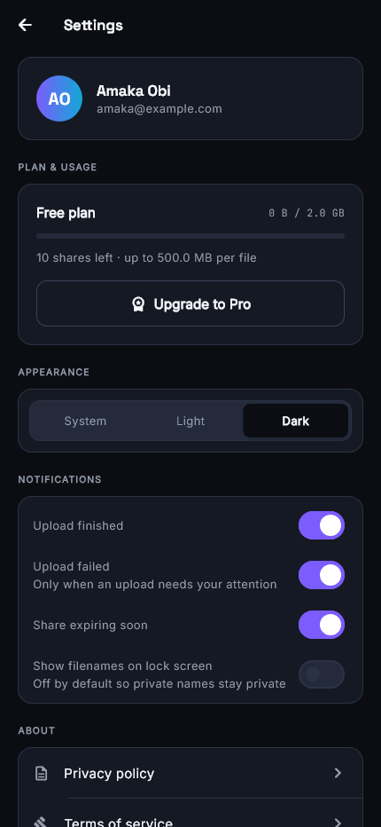 |
| **Transfers** | **Vault** | **Settings** |
| 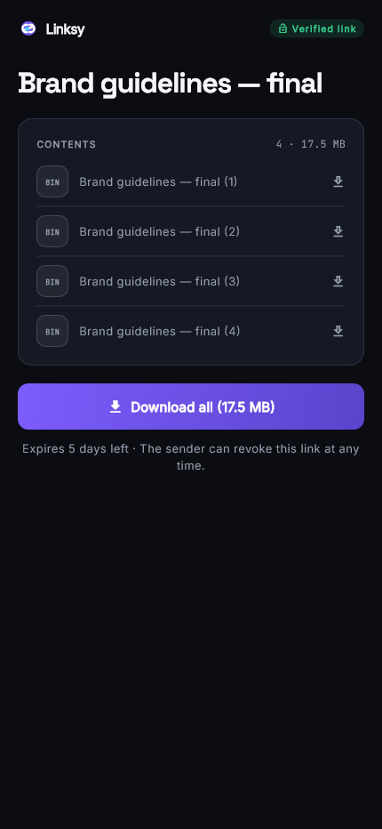 | 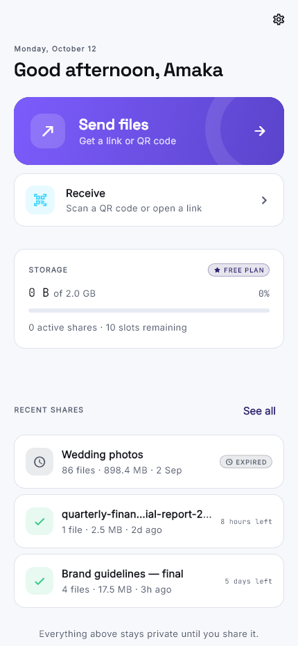 | 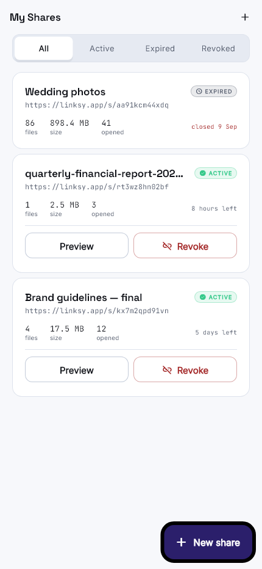 |
| **Receive page** (no account) | **Home** — light | **My Shares** — light |

---

## Running it

```sh
flutter pub get
flutter run                 # connected device or emulator
flutter run -d chrome       # web
```

Verify:

```sh
flutter analyze                 # clean — 0 issues
flutter test                    # 8 unit/widget tests
```

Regenerate the screen captures (a separate file, so `flutter test` doesn't pick
it up by default):

```sh
flutter test test/screenshot_harness.dart --update-goldens   # 13 screens
```

Regenerate the launcher icon for every platform:

```sh
flutter test test/generate_icons.dart --update-goldens       # 25 icons
```

Toolchain used to build this: **Flutter 3.41.6 / Dart 3.11.4**.

`analysis_options.yaml` enables `prefer_const_*`, `directives_ordering`,
`avoid_print`, `unawaited_futures` and `always_declare_return_types` on top of
`flutter_lints`. `require_trailing_commas` was deliberately **not** enabled — it
is purely cosmetic and its ~46 diagnostics across this codebase would be noise
without changing behaviour.

### Screenshots

`screenshots/` holds PNGs of all 13 rendered screens at 430×932 (dark and light),
produced by `test/screenshot_harness.dart`, plus the icon preview sheet.

The harness loads the real bundled typefaces and MaterialIcons first. Without
that, `flutter test` renders every glyph as an Ahem box — uniform width, much
wider than real text — which both makes the images useless and reports false
`RenderFlex` overflows. It earned its keep immediately: the first run surfaced a
sign-in row overflowing by 61px on a 430pt-wide screen, which was a genuine
responsive bug and is fixed.

It is a capture harness, not a golden test — the PNGs are written, not asserted
against, because font rasterisation differs per machine and byte comparison
would fail spuriously.

---

## What is real, and what is not

This matters more than anything else in this README, so it is first.

| Area | State |
| --- | --- |
| Design system, theming, typography | **Real** — light and dark, no hardcoded colours |
| Navigation graph, routing, guards | **Real** — `go_router` with auth + deep links |
| All screens in PRD §8 | **Real** — including empty, loading, error and closed states |
| Upload progress, cancellation, resume | **Real state machine**, locally simulated |
| QR generate | **Real** — scannable code from `qr_flutter` |
| QR scan | **Real** — `mobile_scanner`, with manual-entry fallback |
| Persistence (shares, auth, files) | **Stubbed** — in-memory repositories |
| Firebase Auth / Firestore / Storage | **Not wired** — no project configured |
| Subscriptions & payments | **Not implemented** — UI only |
| Nearby / device-to-device transfer | **Not implemented** — out of MVP scope |

### The stub boundary

Repositories are declared as `abstract interface class` in the domain layer:

- `ShareRepository` — `lib/features/sharing/domain/share_repository.dart`
- `AuthRepository` — `lib/features/auth/presentation/auth_controller.dart`

The only in-memory implementations are `InMemoryShareRepository` and
`LocalAuthRepository`, both clearly marked `DEVELOPMENT STUB`. No widget or
notifier imports a data source directly, so going live is:

1. Write `HttpShareRepository implements ShareRepository`.
2. Write `FirebaseAuthRepository implements AuthRepository`.
3. Change the two `Provider` definitions in their controller files.

Nothing in `presentation/` moves. That is the entire point of the boundary.

**What the stub must never become:** the thing that decides a share is valid.
`finalize()` already refuses to publish unless every file reached `ready`, which
mirrors the server-side check PRD §6.4 requires — but in production that check
belongs to Cloud Functions, not the client.

---

## The design system

### Colour is semantic, not decorative

The palette from PRD §16 is used, but two accent hues carry **fixed meanings**:

| Colour | Meaning | Used for |
| --- | --- | --- |
| Violet `#7C5CFC` | the sender's **intent** | primary actions, the mark, user choices |
| Cyan `#39D5FF` | data **in transit** | live progress, scanning, anything moving |
| Green `#35C98A` | complete | verified, ready, live |
| Amber `#F5B544` | attention | warnings, interruption |

Because each hue means exactly one thing, neither is ever used as a decorative
wash. That is specifically what keeps this from collapsing into the
purple-gradient look that most dark apps default to.

Light theme is authored explicitly, not inverted — dark surfaces get their own
tuned tones rather than flipped light values, which produce crushed greys and
dead borders.

### Typography

| Family | Job |
| --- | --- |
| **Space Grotesk** | display and headings — technical, angular, brand |
| **Inter** | all UI and body copy |
| **JetBrains Mono** | filenames, byte counts, share IDs, URLs, checksums |

The mono face is not decoration. A filename, a size and a share slug are literal
machine values, so they get a literal machine face. It also makes columns of
metadata align, which a proportional face cannot.

All three are bundled as OFL 1.1 TTFs in `assets/fonts/`, so the app renders
identically offline.

### The signature element: `TransferRail`

`lib/core/painters/transfer_rail.dart`

A file transfer is data physically moving between two devices, so the app shows
that movement as a literal rail — nodes for *select → upload → link → done*, a
filled track for what finished, and a travelling cyan packet for what is
happening now. It is the product's state machine drawn, not decoration laid over
it, and it is the one element that makes the app recognisable.

It respects reduced-motion: the packet stops travelling and holds position.

### The hero moment

`ShareReadyScreen` reveals the QR code behind a sweeping mask. Getting the code
onto the other person's phone is the thing the user actually came to do, so it
gets the strongest moment in the app.

### Accessibility

- **State is never colour alone.** Every status badge carries an icon *and* a
  word; file-type chips carry a monogram (`IMG`, `PDF`, `XLS`).
- Minimum touch target is 52px, above the 48dp floor.
- Text scaling honoured from 0.9× to 1.4×; the clamp prevents fixed-height
  controls from clipping.
- All icon-only buttons carry tooltips and semantic labels.
- The QR code renders pure-black-on-white so it scans under any camera.

---

## Architecture

Feature-first, three layers per feature:

```
lib/
  app/            router, theme wiring, preferences
  core/           theme tokens, widgets, painters, utils
  features/
    auth/         domain  presentation/
    home/         presentation/
    sharing/      domain  data/  presentation/
    transfers/    domain  presentation/
    vault/        presentation/
    qr/           presentation/
    receiving/    presentation/
    settings/     presentation/
  main.dart
```

**Rules the codebase holds to:**

- Widgets render and dispatch. They do not call HTTP, storage or policy.
- Notifiers own state transitions. They do not build HTTP clients.
- Repositories orchestrate. They do not touch `BuildContext`.
- Domain is pure Dart with no Flutter imports. This is enforced: `FileUploadState`
  carries a `label` but no `IconData`, and the icon mapping lives in
  `core/widgets/status_badge.dart` as an extension.
- Dependencies are injected through providers, never constructed inline.

### Typography accessors

`TextTheme` exposes role-based slots (`headlineMedium`, `titleLarge`, …), which
don't distinguish the two things this product cares about: *machine value* vs
*prose*, and *display* vs *heading*. An extension in `app_typography.dart` adds
`t.heading`, `t.subheading`, `t.bodyStrong`, `t.caption`, `t.monoValue` and
friends, so call sites read like design intent rather than leaking M3 slot names.

### State management

**Riverpod 2.6.1**, not 3.x. Riverpod 3 is the current recommendation, but this
machine's pub cache only carries 2.6.1 and the Flutter 3.41 toolchain resolves
against it. The API used here (`NotifierProvider`, `Notifier`, `ref.watch`) is
forward-compatible with 3.x, so upgrading is a version bump plus regenerating
the notifier signatures — no screen changes.

`ShareDraftController` is deliberately **not** auto-dispose. PRD §6.5 requires an
upload to keep running coherently when the user navigates away, so that state has
to outlive the screen that started it. It surfaces on the Home dashboard while
running.

### Codegen decision

Models are **hand-written immutable classes with `Equatable`**, not `freezed`.

The PRD says freezed "if adopted", so this was a deliberate call. Reasons:

1. `build_runner` adds a build step and a class of version-mismatch failures
   (the cache on this machine holds five `analyzer` versions) for no runtime gain.
2. Zero generated files means a clean checkout compiles immediately.
3. The domain is small and explicit — `Share`, `SharedFile`, `Transfer`,
   `VaultItem`, `AccessPolicy`, `Expiry`, `AppUser`.

Swapping to freezed later is mechanical and touches only the domain layer.
Riverpod providers are hand-written for the same reason; that is explicitly
endorsed in current Flutter guidance for non-team projects.

---

## Permissions and platform notes

`mobile_scanner` needs camera access. iOS `Info.plist` must carry
`NSCameraUsageDescription`; Android needs the `CAMERA` permission. Neither was
added here because platform folders are generated by `flutter create` and should
be configured alongside the real Firebase project.

`file_picker` is called with `withData: false` so large files are never loaded
into the Dart heap. A cloud document provider may hand back a temporary URI
instead of a readable path — `SharedFile.localPath` is therefore nullable and no
code may assume a local file exists.

---

## Known gaps

These are deliberate, not oversights:

- **No backend.** Everything persists in memory; a restart loses shares.
- **Payments and plans** are UI only — `Upgrade to Pro` shows a notice.
- **Privacy policy and terms** screens are stubs, as required for launch but not
  written.
- **Native transfer** (PRD §11 phases 2–3) is not implemented. The PRD is correct
  that Flutter cannot provide this cross-platform, and no amount of UI will
  change that.
- **No widget-level golden tests.** The screenshot harness captures all screens
  but does not diff them, so visual regressions are caught by eye rather than CI.
- **`LsScaffold` owns one scrolling contract.** Screens pass a plain widget; the
  scaffold supplies the scroll view and pins `bottomBar` below it. Screens must
  not pass their own `ListView` into it.